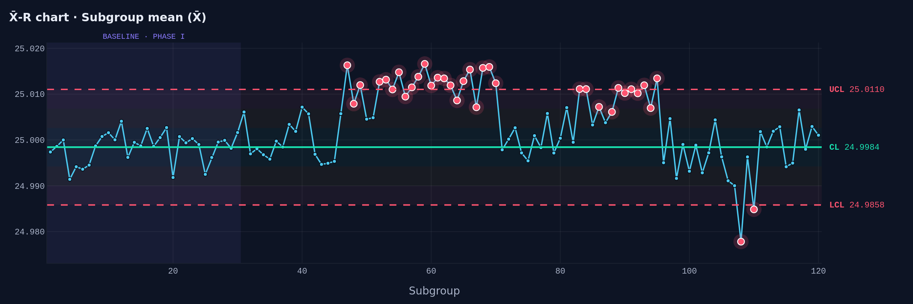
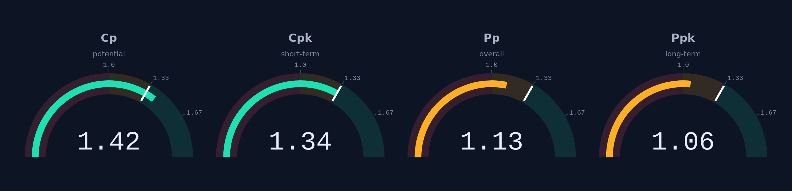
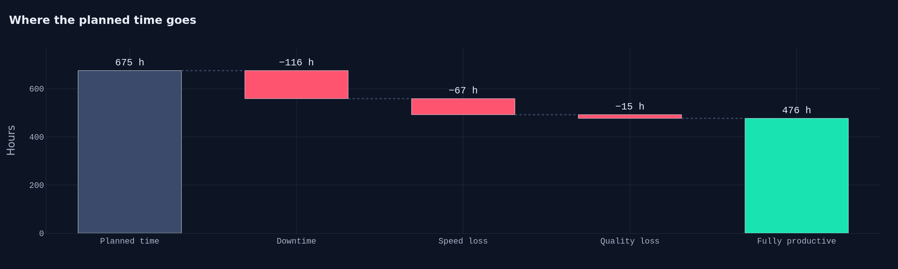
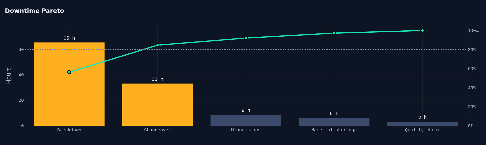

# 📊 SPC & OEE Quality Dashboard

**Control charts, process capability and OEE analysis for manufacturing, built with Python and Streamlit.**

Academic project · Telkom University · Industrial Engineering (MEng)

🔗 **Live demo:** <add-your-streamlit-link-here>

## 🎯 Problem

Two questions drive quality and productivity on any shop floor:

1. **Is the process stable and capable?** Control charts show *when* something changed,
   and capability indices (Cp, Cpk, Pp, Ppk) show whether parts meet specification.
2. **How much of the planned time is truly productive?** OEE splits losses into
   availability, performance and quality so improvement effort goes where it pays off.

This dashboard answers both from simple CSV files, with the formulas implemented
from scratch and covered by unit tests.

## ✨ Features

| Tab | What it does |
|-----|--------------|
| 📈 Control charts | X̄-R and I-MR charts, Phase I baseline limits, Western Electric / Nelson run rules, signal table |
| 🎯 Capability | Cp, Cpk, Pp, Ppk, expected ppm out of spec, histogram with spec limits, automatic warnings (off-center, drift, process not in control) |
| ⚙️ OEE | Availability × Performance × Quality, loss waterfall, downtime Pareto, daily trend, OEE by shift |
| ℹ️ Method | Formulas and interpretation used in the app |

You can use the built-in simulated data or **upload your own CSV files** (column formats are shown in the sidebar).

## 📈 Example findings (simulated data)

The sample data simulates a shaft-diameter process (spec 25.000 ± 0.040 mm) with injected events,
and a machining cell over 30 days × 3 shifts.

**Control charts.** 35 of 120 subgroups raise a signal, caused by a sudden mean shift,
tool-wear drift and a short period of unstable variation. The range chart also catches a single outlier.

**Capability.** Short-term capability looks fine, but long-term performance does not:

| Index | Value |
|-------|------:|
| Cp | 1.42 |
| Cpk | 1.34 |
| Pp | 1.13 |
| Ppk | 1.06 |
| Expected out of spec | ~874 ppm |

The gap between Cpk and Ppk shows that shifts and drift *between* subgroups cost capability.
Capability indices are only trustworthy when the process is stable, and the app warns when it is not.

**OEE = 70.6%** (Availability 82.7% × Performance 88.1% × Quality 96.9%).

Breakdowns and changeovers account for about 85% of downtime, and the night shift (OEE 66%)
trails the morning shift (75%).

> ⚠️ All data in this repository is **simulated** (`data_gen.py`, fixed seed). It is not from a real factory.

## 🎨 Design

Dark "control room" interface: Inter and JetBrains Mono typefaces, tabular numerals for all figures,
and a consistent color language (mint = in control / good, amber = warning, red = out of control / loss).
Control charts shade the σ zones, flag run-rule signals with glowing markers, and label limits with their values;
every tab ends with auto-generated insights computed from the data.

## 🧮 Method in brief

- **X̄-R limits:** `X̿ ± A₂·R̄`, range chart `D₃·R̄` and `D₄·R̄`; within-subgroup sigma `σ = R̄ / d₂`
- **I-MR limits:** `X̄ ± 3·(MR̄ / 1.128)`
- **Run rules:** one point beyond 3σ · nine in a row on one side · six in a row trending · two of three beyond 2σ
- **Capability:** `Cpk = min(USL − μ, μ − LSL) / 3σ_within`, with `Pp/Ppk` using the overall standard deviation
- **OEE:** `Availability × Performance × Quality`, aggregated time-weighted (sums first, then ratios)

## 🚀 Getting Started

    git clone https://github.com/Muat01/spc-oee-quality-dashboard.git
    cd spc-oee-quality-dashboard
    pip install -r requirements.txt
    streamlit run app.py

Run the unit tests:

    python -m pytest

Regenerate the sample data (optional):

    python data_gen.py

## 📂 Using your own data

Choose **Upload my CSV files** in the sidebar.

| File | Columns |
|------|---------|
| SPC | `subgroup`, `measurement` (equal subgroup size, 2 to 10) |
| OEE production log | `date`, `shift`, `planned_min`, `ideal_cycle_min`, `total_count`, `good_count` |
| OEE downtime log | `date`, `shift`, `reason`, `minutes` |

Set your real **LSL / USL** in the Capability tab (the defaults for uploaded data are only placeholders).

## 📁 Project Structure

    ├── app.py              # Streamlit dashboard (layout and logic)
    ├── ui.py               # CSS theme and HTML components (cards, pills, callouts)
    ├── charts.py           # Plotly figure builders
    ├── theme.py            # Design tokens: colors and fonts
    ├── spc.py              # Control charts, run rules, capability
    ├── oee.py              # OEE, loss waterfall, Pareto
    ├── data_gen.py         # Simulated sample data generator
    ├── make_docs.py        # Optional: export README figures
    ├── make_assets.py      # Optional: build the LinkedIn carousel
    ├── data/               # Sample CSV files (simulated)
    ├── docs/               # Figures
    └── tests/              # Unit tests (formulas checked against hand calculations)

## 🔭 Possible Extensions

- Attribute charts (p, np, c, u) and EWMA / CUSUM charts for small shifts
- Gauge R&R and measurement system analysis
- Connect to live sensor data and the
  [production line simulator](https://github.com/Muat01/production-line-simulation-simpy)
  to link quality, OEE and throughput

## 👤 Author

**Muatasem Hadi** · MEng Candidate in Industrial Engineering, Telkom University ·
[LinkedIn](https://www.linkedin.com/in/muatasem-hadi)
